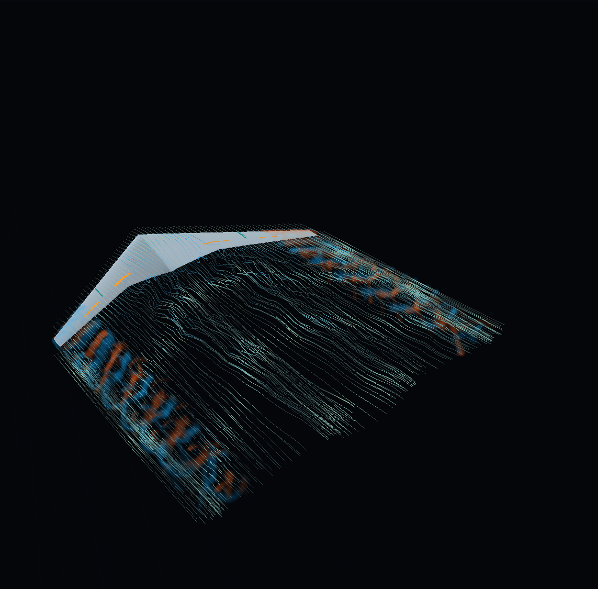
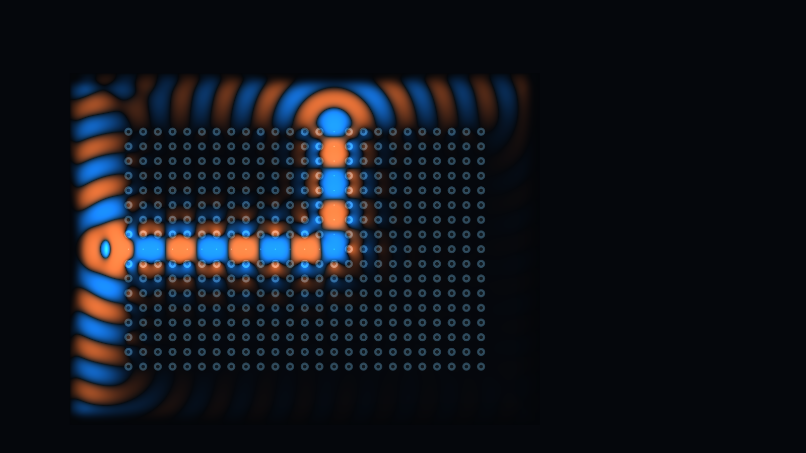
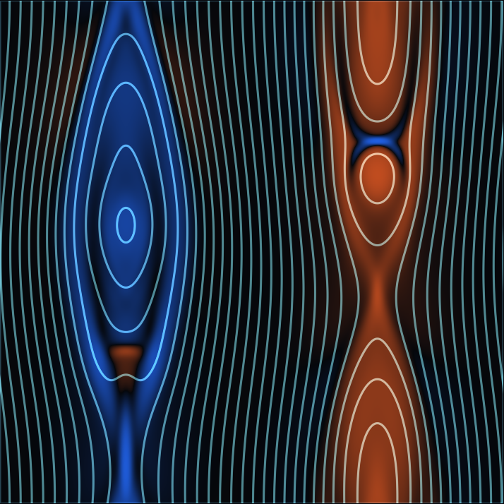

# Interesting Exp Demo

基于自编数值方法的交互式科学计算动画，涵盖流体力学、电磁波传播、磁流体与摆系统控制。每个实验使用独立子目录，并在自己的 README 中说明依赖、启动、关闭和计算范围。

## 实验目录

| 目录 | 实验 | 启动说明 |
|---|---|---|
| `navier-stokes` | Navier–Stokes 爆破解演示动画：局部自相似涡核、旋转层与上下排出通道 | [README](navier-stokes/README.md) |
| `karman-vortex` | 自编 GPU CFD 卡门涡街：圆柱绕流、流速/涡量/流向、缩放与自动网格加密 | [README](karman-vortex/README.md) |
| `kelvin-helmholtz` | 自编 GPU CFD 剪切不稳定：双剪切层、示踪物卷吸、高密度网格与缩放平移 | [README](kelvin-helmholtz/README.md) |
| `wingtip-vortex` | 自编三维 GPU CFD：NASA CRM-HL 参考翼面、研究型翼刀 / 扰流板与自然尾迹 | [README](wingtip-vortex/README.md) |
| `photonic-crystal` | 自编 Maxwell FDTD：光子晶体、缺陷导光、微腔与可调频率 | [README](photonic-crystal/README.md) |
| `solar-reconnection` | 自编二维电阻磁流体：不规则扰动、电流片与磁岛演化 | [README](solar-reconnection/README.md) |
| `triple-pendulum` | 三摆滑轨控制：独立双精度动力学、受限传感与分阶段姿态切换 | [README](triple-pendulum/README.md) |

新增实验时在仓库根目录建立独立子目录，并更新此索引。

三维机翼翼尖涡的实际 CFD 画面，采用公开参考翼面与研究型翼刀 / 扰流板。运行方式见 [实验说明](wingtip-vortex/README.md)，FP32 性能优化实测见 [结果记录](wingtip-vortex/VALIDATION.md)。



光子晶体中的电磁波传播，由自编 Maxwell FDTD 求解缺陷导光、弯道和微腔响应；支持调频、单柱编辑、高密度网格与缩放平移。模型、性能对照及 CUDA / DLSS 取舍见 [实验说明](photonic-crystal/README.md)。



磁流体与太阳耀斑相关的重联机制演示：电流片在不规则扰动下演化，颜色表示电流密度，细线表示平面内磁力线。模型近似、数值核对和性能对照见 [实验说明](solar-reconnection/README.md)。



## 获取与运行

```powershell
git clone https://github.com/Bohao-Ding/Interesting-Exp-Demo.git
cd Interesting-Exp-Demo
cargo run --release --manifest-path karman-vortex/Cargo.toml
```

以上命令启动卡门涡街实验，随后打开 `http://127.0.0.1:8766`。安装依赖、操作和关闭方式见各实验 README；克隆仓库本身不会启动计算。
