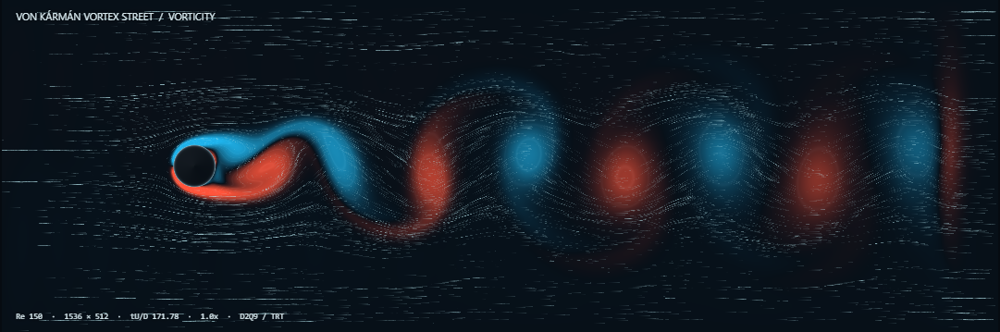
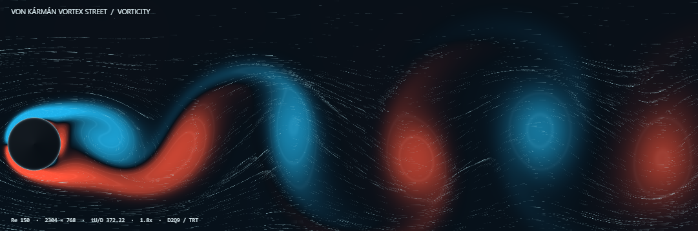

# 卡门涡街 · Flow Laboratory

自行编写的 GPU CFD 圆柱绕流动画。滚轮缩放观察涡街、剪切层与涡核，拖拽移动视野；网格随缩放自动加密，当前涡街继续演化。支持流速、涡量、流向三种色图，以及随流粒子轨迹、暂停、全屏、PNG 截图和 8 秒 WebM 录制。





[已保存的核对结果](VALIDATION.md)

## 启动与关闭

依赖 Rust stable（edition 2024）及支持 WebGPU、开启硬件加速的现代 Chrome / Edge 或应用内浏览器。Windows Rust MSVC 工具链需要 C++ 构建工具与 Windows SDK。没有第三方 Cargo / npm 依赖，无须安装 CFD 引擎。

Rust 安装见 [官方说明](https://www.rust-lang.org/tools/install)。安装后可用 `rustc --version` 和 `cargo --version` 确认工具链。

从仓库根目录运行：

```powershell
cargo run --release --manifest-path karman-vortex/Cargo.toml
```

也可进入 `karman-vortex` 目录运行 `cargo run --release`。首次会编译本地文件服务。

打开 [http://127.0.0.1:8766](http://127.0.0.1:8766)。首次打开会真实预演化流场至约 tU∞/D = 64；等待时间由 GPU 性能决定。Rust 提供本机文件服务并保存预览，全部流体计算与绘制都在浏览器 GPU 中完成。此实验与 `navier-stokes` 的 8765 端口分开。

**完全停止：先关闭动画页面，释放 GPU 计算与绘制；再在运行 Cargo 的终端按 Ctrl+C，关闭本机服务。** 只关闭服务不会终止已经加载到浏览器中的 GPU 求解器。暂停按钮冻结流体时间，仍可缩放、平移、切换色图与截图，因此页面仍会绘制。

请通过本机 HTTP 地址打开，不要直接双击 `index.html`。若页面提示没有可用 WebGPU，请检查浏览器硬件加速并使用支持 WebGPU 的浏览器；程序不会自动改用 CPU。若 8766 端口被占用，先关闭此前启动的本实验服务。

## 观察与网格

- 滚轮：围绕鼠标所在位置缩放，最大 16×；拖拽：平移。点击画布后也可用方向键平移、Home 恢复全域。
- 双击或「全域」：恢复完整计算区域；+ / − 也可缩放。
- 自动网格：1536×512 → 2304×768 → 3072×1024，最高 3,145,728 个单元；缩小时回落。停止滚轮操作约 0.35 秒后更新求解网格。
- 自动模式在放大超过 1.6× 时使用 2304×768，超过 3.2× 时使用 3072×1024。实际帧率取决于 GPU、画布尺寸和每帧演化步数；“演化速度”控制每帧计算步数，动画与真实墙钟时间不绑定。
- 手动网格：1152×384、1536×512、2304×768、3072×1024。选择后直接重映射，无须重新生成。
- 放大与加密使用同一个物理区域，均保持长宽比 3:1、Re、圆柱物理尺寸和无量纲时间。圆柱直径分别为 48、64、96、128 个网格单元。
- 网格切换采用分布函数双线性插值、平衡/非平衡分解和声学缩放下的 TRT 模态重标度；粒子位置与寿命同步缩放。重映射有短暂离散误差，并非严格守恒的局部 AMR。
- 自动模式使用**全域均匀网格加密**。超过最高网格后继续放大只改变观察视野，不增加已解析的物理尺度。
- 更改 Re 后点击「重新生成」。空格暂停/继续，F 全屏。截图保存为本实验 `output/preview.png`，视频保存为 `output/recording.webm`；再次保存会覆盖同名预览。

## 计算与色图

二维、弱可压缩、等温、单相的 D2Q9 格子玻尔兹曼方法，使用自己编写的 TRT 碰撞与 pull streaming。没有预设涡街轨迹。初始场仅包含一次局域横向微扰，后续交替脱涡由求解器演化形成。

格子单位来流速度 U∞ = 0.07，默认 Re = 150；ν = U∞D/Re，τ⁺ = 1/2 + 3ν，(τ⁺ − 1/2)(τ⁻ − 1/2) = 3/16。圆柱使用链路半程反弹无滑移边界；左侧为 Zou/He 定速入口，上下为镜面反射自由滑移边界，右侧为零梯度开放出口和最后 2D 长度的海绵层。海绵层将分布函数缓慢松弛向来流平衡态，会吸收扰动和改变局部质量/动量。

流速使用蓝→青→绿→黄→红的顺序色图，标度为 |u|/U∞。涡量使用蓝/红发散色图表示相反旋向，标度为 ωD/U∞；为了看清弱尾流，对 |ωD/U∞|/5 采用 0.55 次幂色彩映射，超过 ±5 饱和。流向使用周期色图，右向为青、左向为红，并辅以速度箭头。随流轨迹为 16,384 个有限寿命示踪粒子的 RK2 积分历史。

这是二维层流脱涡演示。有限域、自由滑移边界、圆柱阶梯离散、弱可压缩性和网格重映射会影响脱涡频率与细节；未进行系统域宽/网格收敛或力系数验证，不用于三维湍流、自由液面或工程载荷预测。

## 必要核对

开发检查地址 [/?verify=1](http://127.0.0.1:8766/?verify=1) 会在页面底部显示一次全域场扫描以及尾流横向速度探针的脱涡周期；普通观看地址不执行这些 GPU 回读。网格切换后重新扫描并重新统计探针。Strouhal 数通过探针同方向过零周期计算，没有被求解器指定。

已保存的场扫描、脱涡探针与网格切换观察见 [VALIDATION.md](VALIDATION.md)，对应的小型 JSON 摘要随仓库保存在 `validation/`。固定预览图片保存在 `assets/`。自行生成的截图、视频和临时核对结果保存在本地 `output/`，构建缓存位于 `target/`；这两个目录均不加入版本控制。

核对覆盖着色器/脚本加载、实际交替脱涡、场的有限性与密度范围，以及放大加密/缩小回落后的连续演化；不代表独立的网格收敛或工程验证。

## 文件与方法来源

`src/main.rs`：本机文件服务；`app.js`：GPU 调度、交互与网格切换；`simulation.wgsl`：求解与示踪粒子；`remesh.wgsl`：网格重映射；`render.wgsl`：色图与轨迹；`verification.js`：可选数值回读。

- [Zou & He：压力/速度边界条件与反弹边界](https://arxiv.org/abs/comp-gas/9611001)
- [Ginzburg et al.：TRT 参数化与边界条件](https://www.global-sci.com/cicp/article/view/5523)
- [Nash et al.：曲面反弹与插值边界的精度比较](https://arxiv.org/abs/1211.0205)
- [WebGPU 设备与浏览器要求](https://developer.mozilla.org/en-US/docs/Web/API/GPUAdapter/requestDevice)
