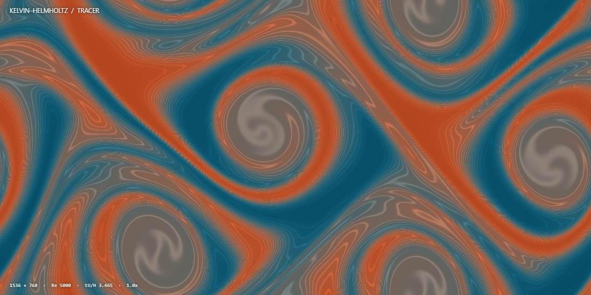

# Kelvin–Helmholtz 剪切不稳定

自编二维 GPU CFD：中央流层向右，上下流层向左，平滑剪切层在初始微扰作用下卷起为“猫眼涡”。两色示踪物显示卷吸、拉伸和混合；也可切换涡量、流速，叠加速度箭头。没有使用现成 CFD 引擎。



## 启动与停止

需要 Rust stable（支持 edition 2024）以及支持 WebGPU、开启硬件加速的浏览器。Windows 使用 MSVC 工具链时需要 C++ 构建工具与 Windows SDK。没有第三方 Cargo 或 npm 依赖。

在仓库根目录运行：

```powershell
cargo run --release --manifest-path kelvin-helmholtz/Cargo.toml
```

然后打开 [http://127.0.0.1:8767](http://127.0.0.1:8767)。也可进入此目录直接运行 `cargo run --release`。Rust 负责本机文件服务及保存图片，流体与示踪物计算、显示均在浏览器 GPU 中进行。

初次打开会真实预演化到 tU/H≈1，等待时间取决于设备。点击「重新开始」可从平直剪切层开始观看；开启「循环」时，tU/H=6 后重新初始化并短暂预演化至约 0.4。循环会重置物理时间，没有持续驱动或指定涡旋轨迹。

**完全停止：关闭动画页面，再在 Cargo 终端按 Ctrl+C。** 只关闭本机服务不会停止已加载的 GPU 计算。暂停冻结物理时间，仍会绘制并允许缩放与平移。

若提示没有可用 WebGPU，请使用支持 WebGPU 的浏览器并开启硬件加速；通过 HTTP 地址打开，不要双击 `index.html`。若端口 8767 被占用，请先停止此前的本实验实例。

## 观察操作

- 滚轮以鼠标位置为中心缩放，最大 20×；拖拽平移。
- 点击画布后可用方向键平移，Home 恢复全域；双击或「全域」也可恢复总览。
- 空格暂停/继续，F 全屏。
- 自动网格默认 1536×768（1,179,648 单元）；超过 1.6× 时加密到 2048×1024，超过 3.2× 时加密到 2560×1280（3,276,800 单元）。停止缩放约 0.35 秒后重映射，缩小时回落。
- 手动网格可选择 1024×512、1536×768、2048×1024 或 2560×1280。全域始终为 2H×H；网格变化保留 Re 和当前无量纲时间，并插值当前分布函数和示踪物。它是全域均匀加密，有重映射离散误差。
- 更改 Re 后点击「重新开始」。演化速度控制目标物理时间推进率；设备负载较高时会降低实际推进速度。
- 截图保存至本实验的 `output/preview.png`，再次保存会覆盖；固定展示图片位于 `assets/`，没有视频文件。

## 方程与离散

等初始密度、低 Mach 数、二维周期域的 D2Q9 格子玻尔兹曼流体求解，使用 TRT 碰撞与 pull streaming。上下、左右均周期，无圆柱、入口、出口或海绵层。格子速度 U=0.05，Re=UH/ν，默认 Re=5000；ν=U·Ny/Re，τ⁺=1/2+3ν，(τ⁺−1/2)(τ⁻−1/2)=3/16。

以 X=x/(2H)、Y=y/H 表示初始场，令 a=0.025：

```text
b(Y) = 0.5 [tanh((Y−0.25)/a) − tanh((Y−0.75)/a)]
u_x  = U [2b(Y)−1]
u_y  = 0.02 U [sin(8πX) + 0.35 sin(4πX+0.3) + 0.1 sin(2πX+0.7)]
ρ    = 1
c    = b(Y)
```

主扰动有四个周期，较长波扰动用于打破完全对称的涡列。此处 Re 使用域高 H 和单侧速度 U 定义，速度跳变为 2U。初始速度散度为零，但 LBM 后续求解是弱可压缩的。

示踪物满足 `∂t c + u·∇c = κ∇²c`，κ=ν（Schmidt 数为 1）。使用 MC 限幅 MUSCL 面重构、迎风通量、中心扩散和 SSP-RK2；每 4 个流体格子时间步更新一次示踪物，以该时刻速度冻结推进。对流采用浓度形式的散度修正。色图中的细线由浓度等值线式着色产生，不是额外的小涡或附加计算网格。

网格重映射采用单元中心的周期双线性插值，并按声学缩放重标度碰撞后的 TRT 非平衡模态；示踪物也插值到新网格。没有严格守恒重映射或局部 AMR。

这是可交互的二维演示。可见细丝和高网格密度不构成网格收敛或三维湍流证据；未复现文献参考解，也未作系统 Re、网格和域尺寸收敛研究。

## 必要核对与文件

开发地址 [/?verify=1](http://127.0.0.1:8767/?verify=1) 在启动时运行两个 128×64、1000 步的小网格解析对照：黏性剪切波衰减、均匀流中的正弦示踪物对流扩散。随后回读当前 KH 全场的密度、浓度、横向速度和 Courant 数；重映射后再回读一次。结果位于页面「操作与计算说明」内，并写至 `output/validation.json`。普通观看地址不运行这些核对。

本次已保存的核对见 [VALIDATION.md](VALIDATION.md)，原始 JSON 摘要保存在 `validation/`。长时间单精度续算中观察到域平均密度有少量漂移，因此这些结果不构成质量守恒或网格收敛验证。

`flow.js`：GPU 调度与重映射；`simulation.wgsl`：流体与示踪物；`remesh.wgsl`：全域网格转移；`render.wgsl`：场显示；`app.js`：交互与绘制；`verification.js`：可选解析对照及场扫描；`src/main.rs`：本机文件服务。

`target/` 和 `output/` 是本地生成目录，不加入版本控制。

方法边界参考：[Lecoanet et al.，平滑初值与显式扩散的 KH 核对问题](https://arxiv.org/abs/1509.03630)；[WebGPU 设备要求](https://developer.mozilla.org/en-US/docs/Web/API/GPUAdapter/requestDevice)。本实验自行实现求解，不调用文献使用的 CFD 引擎。
