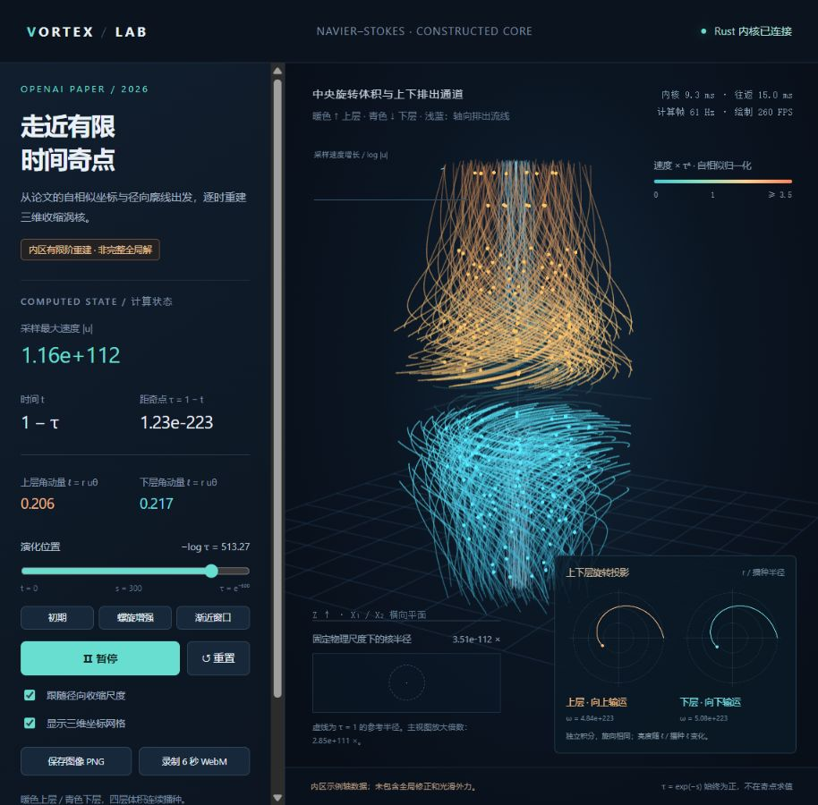

# Navier–Stokes 爆破解演示动画

本实验属于 Interesting-Exp-Demo 工作区。Rust CPU 内核计算三维局部自相似涡核，WebGL 实时显示中央旋转层及上下排出通道。

**科学范围：当前为论文内区的有限阶 leading field 重建，并非完整全局爆破解复现。** 具体范围与公式对应见 [构造说明](construction_notes.md)。

## 安装依赖

- Rust stable 工具链（支持 edition 2024），包含 `rustc` 和 `cargo`。通过 [Rust 官方安装说明](https://doc.rust-lang.org/book/ch01-01-installation.html) 安装。
- Windows 使用 MSVC 工具链时，还需要 Visual Studio 的 C++ 构建工具、MSVC 编译工具和 Windows SDK；按 rustup 安装程序提示安装即可，见 [官方 Windows 说明](https://rust-lang.github.io/rustup/installation/windows-msvc.html)。
- 支持 WebGL 的现代浏览器。PNG 导出使用 Canvas；WebM 录制还需要浏览器支持 MediaRecorder。

后端只使用 Rust 标准库，`Cargo.toml` 没有第三方依赖。启动和观看演示不需要 Python、NumPy、Numba、Node.js、npm 或 GPU 计算环境。计算运行在 CPU，浏览器负责渲染。

安装后在新终端检查：

```powershell
rustc --version
cargo --version
```

## 启动服务

在 PowerShell 中进入本实验目录后运行：

```powershell
Set-Location E:\Interesting-Exp-Demo\navier-stokes
cargo run --release
```

若仓库放在其他目录，将上述路径换成你自己的克隆位置。首次启动会先编译；终端出现 `http://127.0.0.1:8765` 后，在浏览器打开该地址。服务仅监听本机，终端需要保持运行。

也可从仓库根目录启动：

```powershell
cargo run --release --manifest-path navier-stokes/Cargo.toml
```

页面支持播放/暂停、拖动时间、鼠标旋转、滚轮缩放、保存 PNG 和录制 6 秒 WebM。网页的“暂停”只暂停时间演化。

## 关闭与重新启动

1. 回到执行 `cargo run --release` 的终端，按 **Ctrl+C**，即可停止 HTTP 服务和计算进程。
2. 浏览器标签页可随后关闭；**只关闭网页不会关闭服务**。
3. 再次运行同一启动命令即可重启。

若启动提示端口 8765 被占用，先停止此前启动的这个演示实例。不要同时运行原迁移目录中的旧服务和新服务。

## 必要的数值核对与导出

```powershell
cargo run --release -- --verify
cargo run --release -- --export
```

`--verify` 输出局部廓线、散度及粒子步长对照后退出；`--export` 将核对结果和五个初期 JSON 帧写入本实验的 `output/` 目录后退出。这两个模式不启动 HTTP 服务。

## 文件布局

```text
navier-stokes/
├── Cargo.toml / Cargo.lock
├── src/main.rs             # 本地 HTTP 服务、JSON/二进制场帧
├── src/profile.rs          # Rust 数值内核与轨迹积分
├── index.html              # WebGL 显示和浏览器录制
├── README.md
├── construction_notes.md   # 论文构造与实现边界
├── paper/source_map.json   # 来源与公式对应
├── assets/preview.png      # 示例截图
└── output/                 # 本地生成结果，不加入版本控制
```

`paper/` 中下载的 PDF、提取文本和页面图片是本地参考材料，不参与构建，也不加入版本控制；换一台机器时可通过 [论文原文](https://cdn.openai.com/pdf/32d9f210-8b73-45e0-91bc-82a30aef8a9a/navier-stokes.pdf) 获取。`output/` 保留本次迁移的历史结果，重新克隆后可用 `--export` 或页面导出按钮生成新结果。

## 效果预览



## 当前视图

- 径向廓线范围 X≤0.08，相比先前 X≤0.02，半径扩大两倍、截面积扩大四倍。
- 中央旋转体积 |z|≤0.4√τ；围绕材料分隔面在四个轴向层独立播种，显示上下两组旋转和输运。
- 上下排出通道继续延伸至 |z|≤0.95√τ，增加靠近轴线的流线采样。中央层边界不再截断排出轨迹。
- 三轴使用相同的物理缩放；暖色为上侧播种层，青色为下侧播种层。浅蓝为瞬时轴向流线。旋向由速度场决定，上下两侧并非反向旋转。
- 随流轨迹使用物理时间的中点 RK2。亮度随单位质量轴向角动量 ℓ=r uθ 相对播种值变化；这不是完整角动量通量或其守恒量的可视化。
- 为看清不断收缩的内区，主视图默认统一放大 1/√τ。时间用 s=−logτ 表示，最大 s=600；不在 τ=0 求值。

## 计算范围

依据论文第 4 节与附录 B，构造局部、14 阶径向 Taylor 展开的 leading field，η 方向使用 513 节点 Hermite 插值。当前轴压力取示例函数 −4/(1+η²)²，未使用 Lemma A.5 的匹配数据，也未认证全局参数不等式。

本程序未实现外区匹配、无限阶修正及光滑外力构造。因此这是局部有限阶场的时间演化展示，不能作为完整全局爆破解的数值复现。廓线残差不等同于完整三维 Navier–Stokes 残差。

源论文见 [官方 PDF](https://cdn.openai.com/pdf/32d9f210-8b73-45e0-91bc-82a30aef8a9a/navier-stokes.pdf)（本地参考副本位于 paper/），公式与实现对应见 [构造说明](construction_notes.md)。

## 本次结果

`output/verification.json`：扩大径向区域后，14 阶与 10 阶廓线最大差约 6.95e−13，有限差分相对散度约 5.02e−10。

`output/trajectory_verification.json`：在 s=500，将积分步长与角步长减半，上下两侧角动量相对差均小于 0.1%。

`output/outflow_checks.json`：在 s=0、200、500、600，对 z/√τ=±0.90、r/√τ=0.04 取样，上方 uz>0、下方 uz<0。

`output/evolution_checks.json`：对应帧均为有限坐标，上下瞬时流线均到达约 ±0.95√τ；这只核对当前显示区域。

最新预览：`output/outflow_channels.png`、`output/upper_lower_transport.webm`。

## 显示链路优化（2026-10-23）

移除前端每 60 ms 才请求一帧的限制（原上限约 16.7 Hz），按上一请求完成后的可用绘制时机继续请求。暂停时不再重复计算同一时刻。计算帧率只统计收到的新场帧，与绘制 FPS 分开显示。

实时接口改用 `/frame.bin?s=...`：少量 JSON 元数据按 4 字节对齐，随后依次存放五组长度前缀与小端 Float32 数组。前端直接创建 TypedArray 视图上传 WebGL。原 JSON 接口与离线 JSON 导出继续可用。

文字与历史统计以 10 Hz 刷新；上下旋转投影按最新计算帧刷新，最多 60 Hz。流场算法、粒子积分和采样数量没有改变。

在同一 release 可执行文件、s=500、暂停浏览器演化、两种接口交替请求各五次的条件下：

| 完整 HTTP 帧 | JSON | 二进制 |
|---|---:|---:|
| 数据量 | 约 3.40 MB | 约 1.11 MB |
| 往返耗时中位数 | 27.47 ms | 12.49 ms |

浏览器观察到计算帧约 47–83 Hz，随演化位置、负载与浏览器调度变化；绘制约 260 FPS。260 FPS 表示绘制频率，不能解释成每秒计算 260 个独立流场。

在 s=0、500、600 核对全部五组坐标，数量一致、均为有限值。二进制与旧 JSON 的最大绝对差小于 5e−7，来自旧 JSON 文本的有效位舍入；二进制保留原始 f32。

原始记录：`output/frame_performance_before.json`、`output/frame_performance_after.json`。
