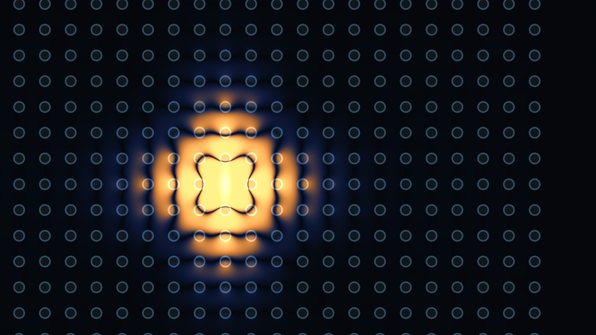

# 光子晶体与电磁波传播

自编二维 Maxwell / Yee FDTD 演示。空气中排列介电常数为 12 的圆柱，通过移除或缩小晶柱形成直通道、90° 弯道和点缺陷微腔。电场、磁场和场强包络来自逐步求解，没有预设光束路径，也不调用现成仿真引擎。Rust 仅提供本地 HTTP 服务，求解和显示在 WebGPU 中执行，无第三方 Rust / npm 依赖。




## 运行与关闭

在仓库根目录运行：

```powershell
cargo run --release --manifest-path photonic-crystal/Cargo.toml
```

打开 [http://127.0.0.1:8769/](http://127.0.0.1:8769/)，需要支持 WebGPU 且启用硬件加速的浏览器。

**关闭动画页面，再在 Cargo 终端按 Ctrl+C，才能同时释放 WebGPU 和本地服务。** 暂停保留显存中的场，只在视角或显示设置改变时重绘。只停止 HTTP 服务不能停止浏览器里已经加载的计算。

## 交互

- 拖拽平移，滚轮以指针为中心缩放，双击或“全域”复位，最高放大 20 倍。
- 频率以 `fa/c` 归一化，范围 0.20–0.48。调频保留当前场和连续源相位，因此能看到切换后的过渡响应。
- 选择完整晶体、直通道、90° 弯道或点缺陷腔。缺陷半径 0 表示移除晶柱，0.20a 表示恢复。开启“点击晶柱移除 / 恢复”后，可直接编辑单个格点；拖动仍用于平移。
- 点缺陷腔使用中心电流源；其他构型使用左侧电流源。进入微腔时建议频率设置为 0.380；这只是观察起点，没有把它作为精确共振频率的测量结果。
- 网格密度为 32 / 64 / 96 点每晶格周期，即 1024×768、2048×1536、3072×2304，最高 **7,077,888 单元**。缩放只改变相机；切换网格、结构或编辑晶柱均从零场重新演化。网格切换保留手动编辑；切换构型会清除编辑。
- 瞬时电场用蓝 / 橙表示负 / 正；另一模式显示约三个驱动周期时间常数的指数平均 `〈Ez²〉`。显示增益不改变求解。关闭持续光源，可以继续观察传播和逸散。
- “保存图片”写入 `output/preview.png`；“数值核对”保存 `output/validation.json`。固定预览为 PNG，不生成视频。
- “模型与核对结果”中的“计算与渲染性能”在当前网格和结构上交替比较原实现与融合实现，分别记录 GPU 求解、渲染和提交墙钟耗时，再核对短程与较长传播的场值，保存为 `output/performance.json`。比较期间暂停当前场，临时分配对照缓冲区，结束后恢复。

## 数值模型

采用二维 TM 极化：`Ez` 垂直于截面，`Hx,Hy` 位于平面内；圆柱沿 z 无限延伸。单位取 `a=c=ε₀=μ₀=1`，空气 `εr=1`，圆柱 `εr=12, μr=1`、半径 `0.20a`，中心在整数方格点 `x=-12…12,y=-8…8`。计算域为 `32a×24a`。

磁场在半时间步、半空间网格上更新，电场使用磁场的离散旋度。时间步 `cΔt/Δx=0.65 < 1/√2`，全场采用 FP32。每格四点面积采样平滑介质边界。光源是有三周期平滑起振包络的高斯空间电流，而不是指定的传播轨迹。

边缘是 2a 宽、三次渐增阻尼的 Berenger 分裂场 PML；`Ez=Ezx+Ezy`，两个方向分别匹配电、磁更新的阻尼率，最外层电场置零。原实现每步分别提交 H、E 更新；默认的融合内核在每个 32×8 小块中先计算新 H 及左 / 下相邻值，同步工作组共享内存后再更新 E。场采用源 / 目标双缓冲，时钟也分两个槽读写，避免跨块覆盖尚未使用的旧时间层。每帧合并计算和显示提交，最多两个批次在途。

显示目标调整为约 120 帧/秒，并按连续截止时间安排刷新，避免原“完成后再等固定间隔”导致的刷新损失；物理播放仍保持每秒推进 `ct/a≈8`。帧率统计的是实际完成的绘制帧，没有插帧。实际呈现仍受浏览器和显示器刷新率限制。

这是无色散、无材料吸收的理想二维介质模型。没有模拟真实有限高度晶柱、基底、面外辐射或材料频散。微腔连续受驱时可以积累能量；局部场强和画面亮度不能直接当成器件功率透射率。

## 已完成的核对

原始记录见 [validation/numerical.json](validation/numerical.json)，2026-10-25，本机 NVIDIA GPU：

- 周期真空平面波，128×96 网格推进 256 步：与 Yee 离散解析解的相对 L2 误差约 `1.02×10⁻⁶`。与连续波解的误差约 1.28%，反映该低密度测试的数值色散。
- 真空高斯脉冲在吸收域内演化至 `ct/a≈100`，剩余能量约初始值的 `2.07×10⁻⁶`。这是该脉冲算例的全域能量衰减，不是通用边界反射系数。
- 相同 512×384 网格、`fa/c=0.36`、相同光源和时间 `ct/a≈180`，完整晶体与直通道的电场均为有限值。出口观察窗的平均 `Ez²` 分别约 `1.18×10⁻⁸` 和 `1.03×10⁻²`，显示此工况下的缺陷导光差别；未将其解释为归一化透射率或独立算得的完整带隙。

优化前的浏览器视觉检查实际运行了最高档 7,077,888 单元，观察约 52 FPS。检查了 0.360→0.200 的连续调频、暂停时缩放 / 平移、晶柱 `(1,2)` 的移除与恢复，以及 0.380 下微腔的局域场与光源关闭。保留的[初版弯道截图](assets/bend.png)和微腔截图均从该自编求解器直接导出；界面帧率属于本机运行观察，未作为独立性能基准或网格收敛结论。

## 计算逻辑优化与 CUDA / DLSS 取舍

2026-10-25，本机 RTX 5070 Ti，FP32，3072×2304、`fa/c=0.36`、弯道缺陷、1600×900 输出。原实现与融合实现从相同初值出发，预热后进行三轮交替计时；网格、时间步、材料和渲染采样均不降低。原始数据见 [performance.json](validation/performance.json)。

| 测量，中位数 | 原实现 | 融合实现 |
|---|---:|---:|
| 128 步，GPU 求解 | 70.189 ms | 56.164 ms |
| 128 步，提交至 GPU 完成的墙钟时间 | 71.3 ms | 58.9 ms |
| 24 步及一帧显示，GPU 求解 | 13.042 ms | 10.486 ms |
| 24 步及一帧显示，墙钟时间 | 15.4 ms | 12.3 ms |

128 步独立求解的吞吐提升约 **25.0%**、GPU 耗时降低约 **20.0%**。主要收益来自 H/E 工作组融合，减少全域中间场读写及 GPU dispatch 数。吸收系数与高斯光源空间因子在初始化时按轴缓存，源相位、起振包络和场强平均系数每块每步只计算一次。单独缓存没有稳定提速，见 [cache-only.json](validation/cache-only.json)，因此没有将它单独当作加速成果。

优化后最高档在页面计数器中观察约 **120 FPS**，约 8,380 百万单元步/秒，物理播放仍为 `ct/a≈8` 每秒。相对初版约 52 FPS 的变化还包括显示上限与截止时间调度的调整，不能全归因于内核；计数器也不等同于显示器实际呈现的帧数。[优化后实际场图](assets/optimized.png)使用原生渲染，未使用 DLSS、超分辨率重建或插帧。

融合使用更多状态存储：两份 E/H 场缓冲区由约 113 MB 增至 226 MB；加上材料和平均场强等，主要网格缓冲约 170 MB → 283 MB。没有逐帧把全场回传 CPU。上述墙钟帧比较使用固定步数、无刷新限速的提交，与按实际时间推进的界面 FPS 是不同指标。

708 万格推进 1,024 步后均为有限值，物理 `Ez` 相对 L2 差约 `9.91×10⁻⁷`；1024×768 网格推进 8,862 步至 `ct/a≈180`，`Ez` 相对 L2 差约 `3.25×10⁻⁶`，平均场强相对 L2 差约 `3.05×10⁻⁷`。空间高斯因子乘法改变了舍入顺序，因此未宣称逐位相同。[优化后的独立核对](validation/numerical-optimized.json)中，周期波误差和吸收脉冲剩余能量与初版记录一致，完整晶体与直通道的局部场强差别也保持。

**本轮未接入 CUDA 或 DLSS。** 渲染 GPU 时间约 0.066 ms，接近时间戳粒度，远小于十余毫秒的求解成本。CUDA 可以作为原生后端继续探索，但需要原生进程及图形资源共享、同步和显示接口；它不是当前 WebGPU 页面中的一个开关，且尚无同算法 CUDA 对照证明迁移收益。[NVIDIA CUDA 互操作说明](https://docs.nvidia.com/cuda/cuda-programming-guide/04-special-topics/graphics-interop.html)

DLSS 超分辨率 / 帧生成处理的是图像，不能替代应完成的 Maxwell 时间步。Frame Generation 的官方接入还需要颜色、深度和运动向量等输入。[NVIDIA 接入文档](https://github.com/NVIDIA-RTX/Streamline/blob/main/docs/ProgrammingGuideDLSS_G.md) 对本演示，我判断快速变号的电场和精细干涉条纹不宜在当前阶段引入重建误差；因此只将其保留为未来显示成本显著增加时的备选，不用于产生数值场。

## 参考依据

- [MIT Photonic Bands 教程](https://mpb.readthedocs.io/en/latest/Scheme_Tutorial/)给出方格介质柱、TM 带隙与点缺陷的基准背景。本项目未运行 MPB。
- [Johnson、Povinelli、Joannopoulos：New photonic-crystal system for integrated optics](https://math.mit.edu/~stevenj/papers/JohnsonPo01-SPIE.pdf)讨论缺陷波导、弯道及微腔的物理机制，也区分二维模型和三维结构。
- [Berenger：A perfectly matched layer for the absorption of electromagnetic waves, JCP 114 (1994)](https://doi.org/10.1006/jcph.1994.1159)为分裂场吸收层依据。
